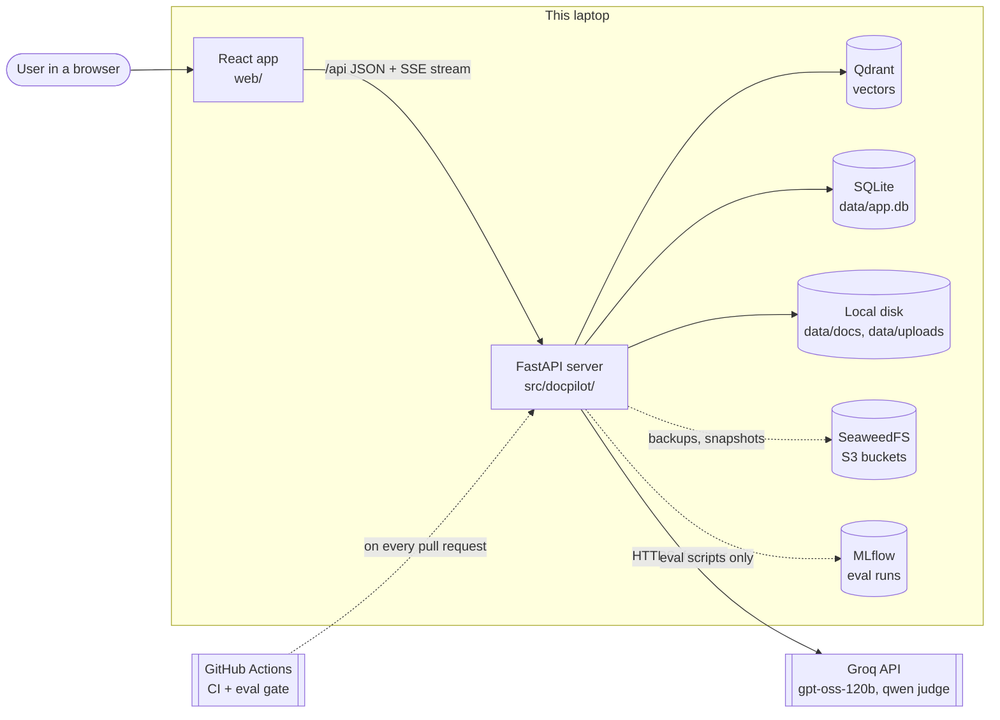
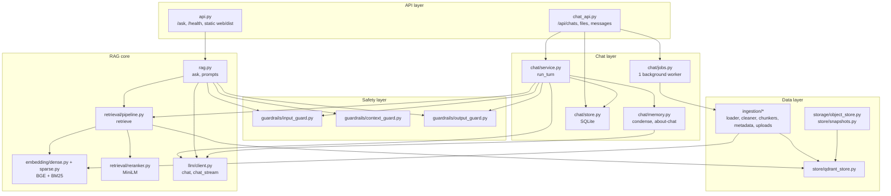
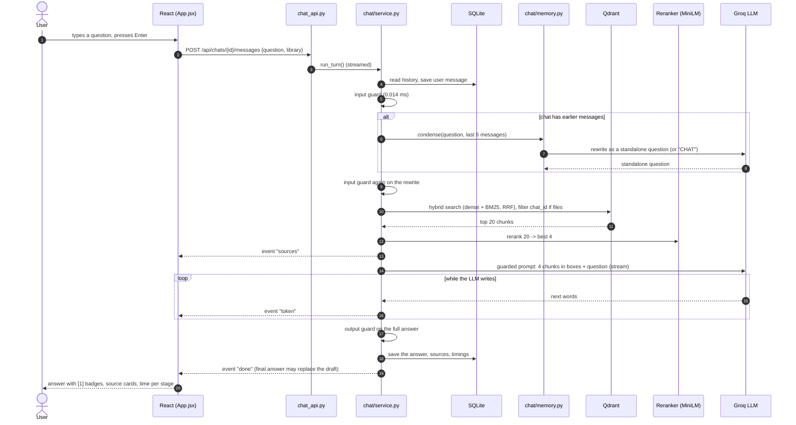
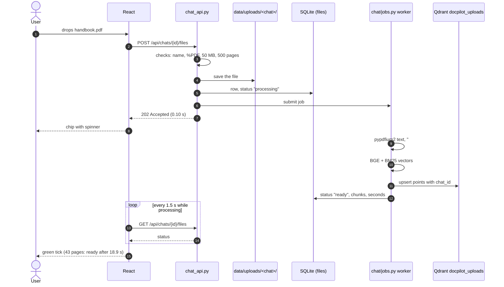
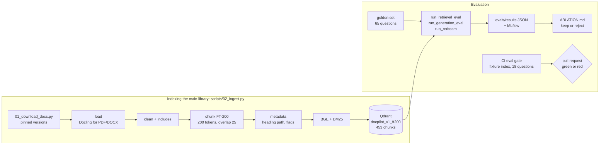
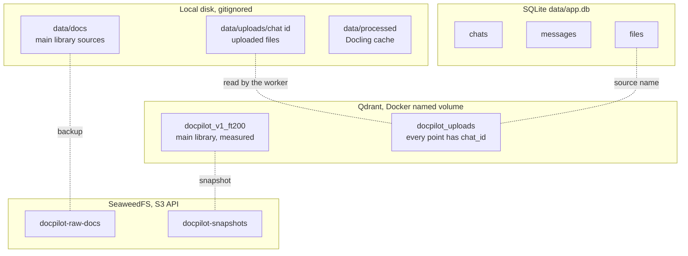

# DocPilot Architecture

Written 2026-10-23. Simple English. The diagrams use Mermaid: GitHub shows them as
pictures (in VS Code, install a Mermaid preview extension). Section 1 is plain text, so it
reads well anywhere. The story under the diagrams explains every box.

---

## 1. One-page overview (plain text)

```text
 ┌──────────────────────────── BROWSER ─────────────────────────────┐
 │  React app (web/)                                                  │
 │  Sidebar: chats    Conversation: streamed answers [1][2]           │
 │  Composer: question box, file chips, "search in" switch            │
 └───────────────┬──────────────────────────────────────▲────────────┘
                 │ HTTP JSON  /api/...                   │ Server-Sent Events (streamed words)
 ┌───────────────▼──────────────────────────────────────┴────────────┐
 │  FastAPI server (src/docpilot/)                                     │
 │                                                                     │
 │  API layer        api.py (/ask, /health, serves web/dist)           │
 │                   chat_api.py (/api/chats, files, messages)         │
 │                                                                     │
 │  Chat layer       chat/service.py  one turn, end to end             │
 │                   chat/memory.py   follow-up rewrite ("condense")   │
 │                   chat/jobs.py     background indexing              │
 │                   chat/store.py    SQLite: chats, messages, files   │
 │                                                                     │
 │  Safety layer     guardrails/ input -> context -> output            │
 │                                                                     │
 │  RAG core         rag.py  ask(), prompts()                          │
 │                   retrieval/pipeline.py  retrieve(): hybrid+rerank  │
 │                   embedding/ BGE (dense) + BM25 (sparse)            │
 │                   retrieval/reranker.py  MiniLM cross-encoder       │
 │                   llm/client.py  Groq, OpenAI-compatible, streaming │
 │                                                                     │
 │  Data layer       store/qdrant_store.py   storage/object_store.py   │
 │                   ingestion/ (offline: load, clean, chunk, tag)     │
 └──────┬──────────────────┬──────────────────┬───────────────┬───────┘
        │                  │                  │               │
   ┌────▼─────┐     ┌──────▼──────┐    ┌──────▼─────┐   ┌─────▼──────┐
   │ Qdrant   │     │ SQLite      │    │ Local disk │   │ Groq LLM   │
   │ 2 colls  │     │ data/app.db │    │ data/...   │   │ gpt-oss-   │
   │ (Docker) │     │             │    │ uploads    │   │ 120b       │
   └──────────┘     └─────────────┘    └────────────┘   └────────────┘
   SeaweedFS (S3 API, Docker): raw-docs + snapshots    MLflow (Docker): eval runs
```

---

## 2. System context: who talks to whom



**Story.** The user only ever sees the React app. Every real decision happens in the
FastAPI server. The server keeps vectors in Qdrant, chats in SQLite, files on the local
disk, and calls Groq for the LLM. SeaweedFS (an S3-compatible store) holds backups, and
MLflow holds evaluation runs; neither is on the path of a normal question. GitHub Actions
tests the code on every pull request, including an eval gate that fails a pull request when
retrieval quality drops.

---

## 3. Backend layers (inside the FastAPI server)



**Story.** Each layer only talks to the layer below it.

- **API layer:** turns HTTP into function calls and back. It validates input with Pydantic
  (too long or empty -> 422 before any of our code runs) and never decides anything about
  RAG.
- **Chat layer:** everything a conversation needs: saved history (SQLite), the follow-up
  rewrite, background indexing, and `run_turn()`, which runs one turn end to end.
- **Safety layer:** three guards, plain Python, about 0.05 ms in total. They wrap every
  path that reaches the LLM: `/ask`, the chat, and the follow-up rewrite.
- **RAG core:** `retrieve()` is the **one front door** for search, used by the app, the API
  and every eval, so the app runs exactly what was measured. `prompts()` is the one
  prompt builder, shared by `ask()` and the streaming chat.
- **Data layer:** `qdrant_store.py` is the only file that talks to Qdrant. Swapping the
  vector database would change one file.

---

## 4. The question pipeline (one chat turn)



**Story.** The browser sends only the new question; the server reads the history itself.
The input guard runs first, so an attack costs no search and no LLM call. If the chat
already has messages, one small LLM call rewrites the question so pronouns like "it" make
sense to search (and detects questions about the chat itself, which are answered from the
history). Hybrid search finds 20 candidates, the reranker keeps the best 4, and the LLM
streams its answer word by word. Because the output guard needs the whole answer, it runs
at the end; if it rejects the draft, the final event replaces it. Real numbers: condense
0.6-0.9 s, rerank about 0.85 s, first words from the LLM after 0.8-1.1 s, whole turn
2.3-3.0 s.

---

## 5. The upload pipeline (files per chat)



**Story.** ChatGPT and NotebookLM also index uploads; they feel instant because the work
happens in the background. DocPilot does the same: the request only checks and saves the
file and returns at once. A single worker thread does the slow part. Each chunk carries the
chat's id, and search in that chat uses a Qdrant filter on it, so other chats never see the
file. For speed, uploads use the pypdfium2 text reader (43 pages: 10.8 s) instead of
Docling (182 s); the price is that tables become plain lines.

---

## 6. The offline pipelines (indexing and evaluation)



**Story.** Indexing turns documents into searchable chunks, once. Evaluation turns every
idea into a number: chunking (11 configurations), hybrid search, two rerankers, four query
transforms, guardrails. Only changes that won on the dev questions were kept; the test
questions were used once, at the end. Every result is tied to a git commit and logged in
MLflow, and the CI gate protects retrieval quality on every pull request.

---

## 7. Where data lives



**Story.** Each kind of data has one home. Vectors live in Qdrant, conversations in SQLite,
original files on disk. The main library and its index can be rebuilt from S3 on a new
machine. Uploaded files are `local_only` (their licence is unknown), so they are not copied
to S3. Deleting a chat removes its rows, its upload folder and its vectors.

---

## 8. Design principles behind the architecture

| Principle | Where you see it | Why |
|---|---|---|
| Measure before you keep | evals/, ABLATION.md, CI gate | Every choice in the pipeline has a number behind it |
| One front door | `retrieve()`, `prompts()` | The app and the evals run the same code |
| The UI has no logic | React only calls `/api` | Guards cannot be skipped; the UI can be replaced |
| Layers talk downwards | API -> chat -> safety -> RAG -> data | Easy to test each layer with fakes (305 tests) |
| One file per outside system | `qdrant_store.py`, `object_store.py`, `llm/client.py` | Swap Qdrant, S3 or the LLM provider in one place |
| Raw first, then the library | Hand-written RRF and metrics before Qdrant fusion | I understand what the library does |
| Free and pinned | Groq free tier, local models with pinned revisions, exact package versions | Reproducible numbers, zero cost |
| Background for slow work | `chat/jobs.py` | The user never waits for indexing |

---

## 9. Limits of this architecture (honest)

| Limit | Effect | Next step |
|---|---|---|
| One API process, one worker thread | Fine for one user; many users would queue | Phase 7: more workers, a job queue |
| SQLite | One file; not for many servers | Postgres |
| Uploads on local disk | Lost if the laptop is lost | S3 with per-user access |
| A job in progress is lost on restart | Its chip stays "processing" | A persistent queue |
| 4 chunks per answer | Whole-book summaries are weak | Map-reduce summaries or a long-context model |
| No monitoring yet | End-to-end p50 under load is n/a | Prometheus + Grafana (next) |
